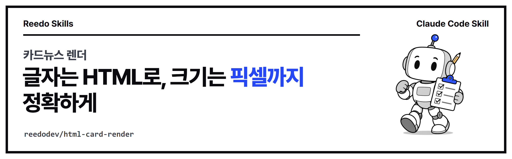

<p align="center"></p>

<p align="center">
<a href="https://github.com/reedodev/html-card-render/actions/workflows/test.yml"></a>


</p>

# 카드뉴스 렌더 (html-card-render)

카드뉴스·배너·썸네일을 HTML로 짜서 크롬 개발자 프로토콜(CDP)로 정확한 픽셀 크기의 PNG로 찍고, 찍기 전에 글자 넘침과 깨진 그림을 자동으로 검사합니다. 설치할 패키지가 없습니다.

## 설치

**Claude Code 플러그인으로 설치**

```
/plugin marketplace add reedodev/html-card-render
/plugin install html-card-render@html-card-render
```

**폴더만 복사**

```bash
git clone https://github.com/reedodev/html-card-render.git
cp -r html-card-render/skills/html-card-render ~/.claude/skills/
```

필요한 것: Node 22+, 크롬·엣지·크로미움

## 바로 해 보기

```bash
node skills/html-card-render/scripts/render.mjs skills/html-card-render/templates/card-4x5.html card.png --size 1080x1350 --scale 2 --pages
```

자세한 절차, 옵션, 한계는 [SKILL.md](skills/html-card-render/SKILL.md)에 있습니다. 에이전트가 이 파일을 읽고 그대로 따릅니다.

## 시험

`node tests/run.mjs`가 SKILL.md 형식을 검사하고 예시 파일로 스크립트를 실제로 실행합니다. 푸시할 때마다 GitHub Actions가 같은 시험을 돌립니다(위 test 배지).

## 만든 사람

**리도**, AI 좌충우돌 실습 중인 20년차 엔지니어입니다. 매일 AI에게 일을 맡기다가 막힌 부분을 고쳐 가며 이 스킬을 만들었습니다.
[YouTube @Reedodev](https://www.youtube.com/@Reedodev) · [Threads @reedo.dev](https://www.threads.com/@reedo.dev) · [GitHub @reedodev](https://github.com/reedodev)

같이 만든 다른 스킬: [옵시디언 3D 지식그래프](https://github.com/reedodev/obsidian-brain-3d) · [노트 먼저 찾아보기](https://github.com/reedodev/vault-recall) · [작업 기록 강의자료](https://github.com/reedodev/work-to-lecture-deck) · [한국어 말투 점검](https://github.com/reedodev/korean-tone-check) · [네이버 황금키워드](https://github.com/reedodev/naver-golden-keywords) · [한글 양식 채우기](https://github.com/reedodev/hwpx-form-fill) · [TTS 끝소리 고치기](https://github.com/reedodev/tts-tail-fix) · [영상 비율 검사](https://github.com/reedodev/social-video-gate) · [유튜브 게시 점검](https://github.com/reedodev/youtube-publish-checklist)

---

## English

Zero-dependency HTML to PNG renderer over the Chrome DevTools Protocol: exact pixel sizes, multi-page card batches, and an in-page overflow / broken-image check before capture.

Install: `/plugin marketplace add reedodev/html-card-render` then `/plugin install html-card-render@html-card-render`, or copy `skills/html-card-render` into `~/.claude/skills/`. See [SKILL.md](skills/html-card-render/SKILL.md) for the full procedure. MIT License; third-party models, fonts and libraries keep their own licenses.
